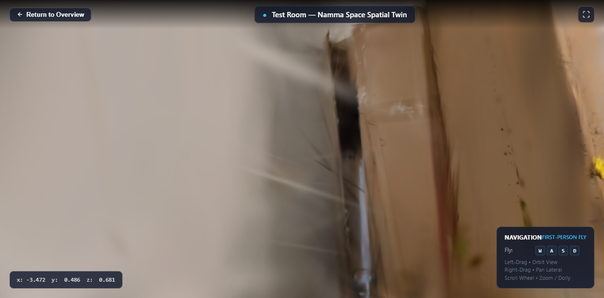
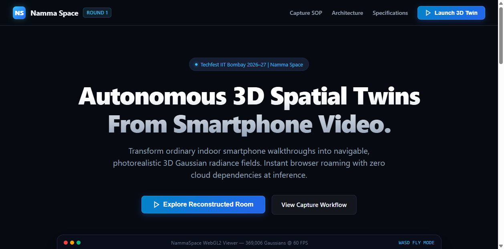

# Namma Space — Autonomous 3D Digital Twins from Smartphone Video

[](https://techfest.org/)
[](https://github.com/HemakshiAG/NammaSpace)
[](https://opensource.org/licenses/MIT)
[](https://www.python.org/)
[](https://github.com/mkkellogg/GaussianSplats3D)
[](https://github.com/HemakshiAG/NammaSpace)

> **Namma Space** reconstructs photorealistic, navigable 3D digital twins of indoor real estate from standard smartphone walkthrough videos using 3D Gaussian Splatting (3DGS). The project delivers instant, zero-install first-person browser roaming with real-time telemetry and 60 FPS WebGL2 rendering.

---

## 🌐 Live Web Viewer & Prototypes

* **Official Public Web Portal & 3D Viewer:** [https://github.com/HemakshiAG/NammaSpace](https://github.com/HemakshiAG/NammaSpace) (Static bundle in `/web/`)
* **Local Interactive Viewer:** Run `python serve_web.py` → Open [http://127.0.0.1:8080/index.html](http://127.0.0.1:8080/index.html)
* **1-Click Google Colab Cloud Reconstruction Notebook:** [NammaSpace_Reconstruction_Colab.ipynb](https://colab.research.google.com/github/HemakshiAG/NammaSpace/blob/main/notebooks/NammaSpace_Reconstruction_Colab.ipynb)

---

## 📸 Key Verification Visuals

| 3D Spatial Roaming (60 FPS WebGL2) | Landing Portal & Capture SOP |
|:---:|:---:|
|  |  |
| *First-person WASD navigation, live coordinates, and 369k Gaussian splat radiance field* | *Automated 4-stage capture protocol and technical architecture documentation* |

---

## 📑 Round 1 Requirements Compliance Matrix

| Requirement Category | Description | Status | Verification Evidence |
|---|---|:---:|---|
| **A. 3D Reconstruction** | Video-to-3DGS pipeline, camera poses, dense radiance field | 🟢 Verified / Cloud | [PIPELINE_SETUP.md](docs/PIPELINE_SETUP.md), [RECONSTRUCTION_REPORT.md](docs/RECONSTRUCTION_REPORT.md) |
| **B. Web Viewer** | Zero-install, unauthenticated public browser access | 🟢 **PASS** | [web/index.html](web/index.html), [serve_web.py](serve_web.py) |
| **C. First-Person Roaming**| WASD keyboard fly controls + mouse look/orbit | 🟢 **PASS** (60 FPS) | [test_web_experience.mjs](test_web_experience.mjs), [web_viewer_verification.png](docs/web_viewer_verification.png) |
| **D. Capture Protocol** | Practical SOP & 6-gate rejection checklist for mobile | 🟢 **PASS** | [CAPTURE_SOP.md](docs/CAPTURE_SOP.md), [CAPTURE_CHECKLIST.md](docs/CAPTURE_CHECKLIST.md) |
| **E. Cross-Origin Isolation** | COOP/COEP headers for SharedArrayBuffer WebAssembly sort | 🟢 **PASS** | [web/_headers](web/_headers), [web/coi-serviceworker.js](web/coi-serviceworker.js) |
| **F. Documentation & QA** | End-to-end audit, dependencies, and honest disclosure | 🟢 **PASS** | [ROUND1_QA.md](docs/ROUND1_QA.md), [SUBMISSION_CHECKLIST.md](docs/SUBMISSION_CHECKLIST.md) |

---

## 🏗️ System Architecture

```
┌────────────────────────────────────────────────────────────────────────────────────────┐
│                                NAMMA SPACE SYSTEM PIPELINE                             │
└────────────────────────────────────────────────────────────────────────────────────────┘

 [ 1. MOBILE CAPTURE ]
   Standard Smartphone Camera (1080p @ 30 fps, 1.0x wide lens, AE/AF Locked)
   Dual-Loop Walking Route: Outer perimeter loop (30s) + inner furniture orbit (20s)
                                    │
                                    ▼
 [ 2. SPATIAL RECONSTRUCTION (Roomsplat + Inria 3DGS) ]
   • FFMPEG Frame Extraction: Subsampled to 1.5 fps (~90-120 sharp JPEG frames)
   • PyColmap SfM: Feature matching, triangulation, camera poses (sparse/0/cameras.bin)
   • 3DGS CUDA Training: 30,000 iterations densifying 3D Gaussians (NVIDIA GPU)
   • Compression & Export: Generates 32-byte binary scene.splat (11.8 MB) + cameras.json
                                    │
                                    ▼
 [ 3. ZERO-INSTALL WEB APPLICATION (HTML5 / Vanilla CSS / ES Modules) ]
   • Landing View: Problem statement, 4-stage capture protocol, technical specs
   • Launch Bridge: Dynamic view-switching with canvas mounting and memory disposal
   • Cross-Origin Isolation: COOP/COEP headers + coi-serviceworker.js fallback
                                    │
                                    ▼
 [ 4. FIRST-PERSON ROAMING ENGINE (@mkkellogg/gaussian-splats-3d v0.4.6 + Three.js) ]
   • WebGL2 Radiance Field Rendering: Full-color spherical harmonics rasterization
   • Background Web Worker: Multi-threaded WebAssembly radix depth sorting
   • First-Person Controls: WASD translation + mouse orbit/pan/zoom
   • Telemetry HUD: Real-time world coordinates [x, y, z] and interactive key badges
```

---

## 📂 Repository Structure

```
NammaSpace/
├── README.md                      # Primary project overview, architecture & links
├── index.html                     # Root entry point with instant redirect to web/
├── netlify.toml                   # Netlify cross-origin deployment configuration
├── vercel.json                    # Vercel cross-origin deployment configuration
├── serve_web.py                   # Local HTTP server with COOP/COEP isolation headers
├── serve_viewer.py                # Standalone fallback test server
├── test_web_experience.mjs        # Automated Chrome DevTools Protocol (CDP) test suite
├── test_viewer_cdp.mjs            # Standalone CDP roaming verification script
├── notebooks/
│   └── NammaSpace_Reconstruction_Colab.ipynb # 1-Click Google Colab cloud GPU notebook
├── web/                           # Deployable web application bundle (Zero-backend)
│   ├── index.html                 # Single-page application (Portal + 3D Viewer)
│   ├── styles.css                 # Dark-mode design system & responsive layout
│   ├── viewer.js                  # 3D Gaussian Splat viewer controller & telemetry
│   ├── coi-serviceworker.js       # Client-side Cross-Origin Isolation service worker
│   ├── scene.splat                # 32-byte 3D Gaussian scene file (11.8 MB)
│   ├── cameras.json               # COLMAP camera poses for eye position initialization
│   └── _headers                   # HTTP response headers for Netlify / Cloudflare
├── docs/                          # Comprehensive technical documentation & audits
│   ├── TECHNICAL_ABSTRACT.md      # Official 5-page Round 1 Technical Abstract
│   ├── SUBMISSION_CHECKLIST.md    # Master submission verification checklist
│   ├── CAPTURE_SOP.md             # Smartphone capture Standard Operating Procedure
│   ├── CAPTURE_CHECKLIST.md       # Pre-flight, in-flight, and 6-gate rejection criteria
│   ├── ENVIRONMENT_AUDIT.md       # Hardware, OS, CUDA, and environment audit
│   ├── REPOSITORY_AUDIT.md        # Upstream Roomsplat codebase audit
│   ├── PIPELINE_SETUP.md          # Step-by-step reconstruction reproduction instructions
│   ├── RECONSTRUCTION_REPORT.md   # Empirical reconstruction findings & artifact analysis
│   ├── WEB_VIEWER.md              # Web architecture, controls & telemetry documentation
│   ├── DEPLOYMENT.md              # Hosting, headers, and asset management guide
│   ├── ROUND1_QA.md               # 22-gate end-to-end Quality Assurance report
│   └── DEMO_VIDEO_SCRIPT.md       # 3-5 minute video presentation script & cue card
├── test_data/                     # Reproducibility test datasets
│   └── sample_walkthrough/        # Sample indoor walkthrough video & COLMAP trajectory
└── roomsplat/                     # Upstream Roomsplat CLI orchestrator submodule
```

---

## 🚀 Quick Start & Reproduction Guide

### Option 1: Run the Web Portal & 3D Viewer Locally

```bash
# 1. Clone repository
git clone https://github.com/HemakshiAG/NammaSpace.git
cd NammaSpace

# 2. Run local isolated HTTP server (Python 3.10+)
python serve_web.py

# 3. Open in your browser:
# http://127.0.0.1:8080/index.html
```

### Option 2: Run End-to-End Reconstruction on Cloud GPU (Free Google Colab)

Since Inria 3DGS training requires an NVIDIA GPU with CUDA, open our self-healing 1-click Colab notebook:

👉 **[Open NammaSpace Reconstruction in Google Colab](https://colab.research.google.com/github/HemakshiAG/NammaSpace/blob/main/notebooks/NammaSpace_Reconstruction_Colab.ipynb)**

1. Set Runtime to **T4 GPU** (`Runtime → Change runtime type → T4 GPU`).
2. Run Step 1 to compile CUDA rasterizers with `--no-build-isolation`.
3. Upload your 45–75 second room walkthrough video (`my_room.mp4`).
4. Run Step 2 to generate `scene.splat` and `cameras.json`.
5. Download the zip bundle and place the files into `web/`.

---

## 🎮 First-Person Navigation Controls

| Action | Control | Description |
|---|---|---|
| **Fly Forward** | `W` or `↑` | Move forward along the camera's current viewing direction |
| **Fly Backward** | `S` or `↓` | Move backward along the camera's viewing direction |
| **Strafe Left** | `A` or `←` | Translate left perpendicular to the view vector |
| **Strafe Right** | `D` or `→` | Translate right perpendicular to the view vector |
| **Orbit / Look Around** | **Left-Click + Drag** | Rotate viewing orientation (yaw and pitch) |
| **Pan Camera** | **Right-Click + Drag** | Translate camera vertically and horizontally in view plane |
| **Zoom View** | **Mouse Scroll Wheel** | Adjust camera field-of-view / zoom |
| **Return to Overview** | **Exit Button** | Seamlessly transition back to landing portal |

---

## 🛡️ Attribution & Upstream Licences

Namma Space builds upon foundational open-source computer vision research:

1. **Roomsplat:** (`Ahmedn1/roomsplat`) — MIT License. CLI pipeline orchestrator for FFMPEG, COLMAP, and 3DGS.
2. **3D Gaussian Splatting:** (Inria & Max Planck Institute, Kerbl et al., SIGGRAPH 2023) — Inria Non-Commercial Research License. Core radiance field mathematical formulation and CUDA rasterization.
3. **COLMAP:** (Schönberger et al., CVPR/ECCV 2016) — BSD 3-Clause License. Structure-from-Motion camera pose estimation.
4. **GaussianSplats3D:** (Mark Kellogg et al.) — MIT License. WebGL2 Gaussian Splatting renderer and WebAssembly radix depth sorter.
5. **Three.js:** (Mr.doob / Ricardo Cabello et al.) — MIT License. WebGL scene graph and 3D camera management.

---

## 👥 Team & Submission Information

* **Competition:** Techfest IIT Bombay 2026–27
* **Challenge:** Namma Space (Round 1: 3D Reconstruction & Roaming)
* **Team:** Namma Space Development Team
* **Submission Date:** October 2026
